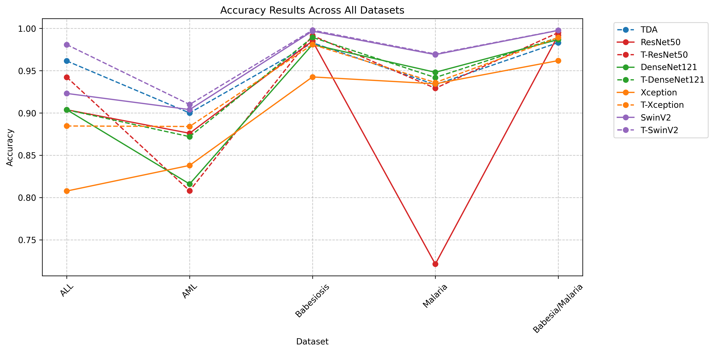
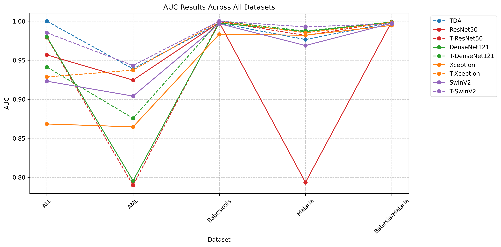

# TopoVita-X

Topological features and deep learning for blood-cell image classification.

[Paper](https://www.medrxiv.org/content/10.1101/2025.01.21.25320908v1) · [Data](#data) · [Usage](#usage) · [Reproducibility](docs/REPRODUCIBILITY.md) · [Citation](#citation)

Research code for **Diagnosis of Blood Diseases and Disorders with Topological Deep Learning**, by Philmore F. Koung, Saba Fatema, Nagehan Pakasticali, Hung S. Luu, and Baris Coskunuzer. The linked paper is the medRxiv preprint posted January 23, 2025.

## Overview

TopoVita-X combines persistent-homology descriptors with image-based models for classifying acute lymphoblastic leukemia, acute myeloid leukemia, malaria, and babesiosis images. The repository includes:

- **Topology-only models:** an MLP and a tabular transformer using 400-dimensional Betti vectors.
- **Image baselines:** CNNs and Swin Transformer V2.
- **Hybrid models:** CNN and Swin V2 image representations fused with topological features.

The code is organized as experiment scripts. Most expect data arrays loaded into their Python namespace; the hybrid Swin scripts contain editable file paths. See the [reproducibility guide](docs/REPRODUCIBILITY.md) for script conventions and implementation details that need attention before reproducing results.

## Repository map

| Path | Contents |
| --- | --- |
| [`betti_vectorization/BettiVectorization.py`](betti_vectorization/BettiVectorization.py) | Cubical persistence and Betti-curve extraction |
| [`models/binaryclass/`](models/binaryclass/) | Binary classification experiments |
| [`models/multiclass/`](models/multiclass/) | Multiclass classification experiments |
| [`plots/`](plots/) | Accuracy and AUC comparison figures |
| [`requirements.txt`](requirements.txt) | Pinned Python dependencies |
| [`docs/REPRODUCIBILITY.md`](docs/REPRODUCIBILITY.md) | Environment notes, script conventions, and known limitations |
| [`CITATION.cff`](CITATION.cff) | Machine-readable paper citation |

Each model directory contains `MLP-*`, `tabtransformer-*`, `CNN-*`, `T-CNN-*`, `swinv2-*`, and `t-swinv2-*` scripts. The `T-` / `t-` prefixes identify hybrid image-and-topology models.

## Setup

Use Python 3.10 or 3.11 in an isolated environment:

```bash
git clone https://github.com/philmorefkoung/TopoVita-X.git
cd TopoVita-X
python -m venv .venv
```

Activate with `source .venv/bin/activate` on Linux/macOS, or `.venv\Scripts\Activate.ps1` in Windows PowerShell. Then install the dependencies:

```bash
python -m pip install --upgrade pip
python -m pip install -r requirements.txt
python -m pip check
```

The scripts use TensorFlow/Keras for CNN and MLP models, PyTorch/timm for transformer models, and giotto-tda/OpenCV for feature extraction. For NVIDIA CUDA 12.4, see the [GPU installation notes](docs/REPRODUCIBILITY.md#environment). Several original scripts assume CUDA; review device selection before running them on a CPU. Dependency resolution and experiment reproduction are separate checks.

## Data

Datasets and prepared train/validation/test splits are not distributed here. Obtain data from the original providers and follow their access terms.

| Dataset | Source |
| --- | --- |
| ALL-IDB | [University of Milan ALL-IDB](https://scotti.di.unimi.it/all/) |
| AML | [TCIA collection linked by the paper](https://www.cancerimagingarchive.net/collection/aml-cytomorphology_mll_helmholtz/) |
| Malaria | [NLM malaria datasets](https://lhncbc.nlm.nih.gov/LHC-downloads/downloads.html#malaria-datasets) |
| Babesiosis / NIAID | [Dataset resource](https://data.niaid.nih.gov/resources?id=mendeley_38jtn4nzs6) |

For each split, prepare an `.npz` archive with `images` and `labels` arrays, plus a CSV of topological features:

```text
data/
  train.npz        # images: (N, H, W, 3); labels: (N,)
  val.npz
  test.npz
  train-betti.csv  # N rows, 400 numeric feature columns, header, no index
  val-betti.csv
  test-betti.csv
```

Keep image, label, and CSV row order identical. Labels must use the selected script's class encoding: `0`/`1` for binary tasks or consecutive integer class IDs for multiclass tasks. Match image dimensions and `num_classes` to the model configuration. The original experiment settings use 128 × 128 images for malaria and babesiosis and 224 × 224 for ALL and AML; several scripts default to 128 × 128.

## Usage

Run these examples from the repository root after preparing your environment and data. They illustrate the script interfaces; they have not been used here to rerun the paper's experiments. The corrected binary transformer paths have a separate [tiny synthetic training/test check](docs/REPRODUCIBILITY.md#evaluation-corrections-and-checks).

### Extract Betti vectors

The extractor expects **OpenCV BGR channel order**. It concatenates 50-bin Betti-0 and Betti-1 curves for grayscale, red, blue, and green, in that order, producing 400 features per image. Convert RGB arrays to BGR before extraction when necessary.

```python
import numpy as np
from betti_vectorization.BettiVectorization import generate_betti_vectors

with np.load("data/train.npz") as data:
    images = data["images"]  # Must be BGR for this extractor.

betti = generate_betti_vectors(images)
betti.to_csv("data/train-betti.csv", index=False)
```

Repeat for validation and test, preserving sample order and preprocessing.

### Train a topology-only binary MLP

Load the variables expected by the existing MLP experiment:

```python
from pathlib import Path
import runpy
import numpy as np
import pandas as pd

data_dir = Path("data")
inputs = {}
for split in ("train", "val", "test"):
    with np.load(data_dir / f"{split}.npz") as data:
        labels = data["labels"].reshape(-1)
    betti = pd.read_csv(data_dir / f"{split}-betti.csv")
    assert betti.shape == (len(labels), 400)
    assert np.isfinite(betti.to_numpy(dtype=float)).all()
    assert set(np.unique(labels)).issubset({0, 1})
    inputs[f"labels_{split}"] = labels
    inputs[f"betti_{split}"] = betti

runpy.run_path("models/binaryclass/MLP-binaryclass.py", run_name="__main__", init_globals=inputs)
```

For other model families, consult the [script input table](docs/REPRODUCIBILITY.md#script-inputs). Configure class counts, image size, pretrained weights, and file paths before starting an experiment.

### Quick execution check

```bash
python -m unittest discover -s tests -v
python scripts/smoke_train_test.py --output outputs/smoke-results.json
```

This runs focused evaluation regressions and one CPU training step per binary transformer model on synthetic data. It uses the actual models without pretrained downloads; it does not measure diagnostic performance.

## Results

Refer to the [paper](https://www.medrxiv.org/content/10.1101/2025.01.21.25320908v1) for experimental protocols and reported results. These are the comparison plots included in this repository, not new benchmark runs.

### Accuracy



### AUC



## Citation

If you use this work, please cite the paper. GitHub's **Cite this repository** action is supported by [`CITATION.cff`](CITATION.cff).

```bibtex
@article{koung2025diagnosis,
  title   = {Diagnosis of Blood Diseases and Disorders with Topological Deep Learning},
  author  = {Koung, Philmore F. and Fatema, Saba and Pakasticali, Nagehan and Luu, Hung S. and Coskunuzer, Baris},
  journal = {medRxiv},
  year    = {2025},
  doi     = {10.1101/2025.01.21.25320908},
  url     = {https://www.medrxiv.org/content/10.1101/2025.01.21.25320908v1}
}
```

## Acknowledgements and license

We thank the dataset creators and the developers of the scientific Python libraries used in this work. Please also cite the datasets and methods relevant to your experiments.

This repository does not currently include a code license. The preprint's license does not establish a license for the repository code.
